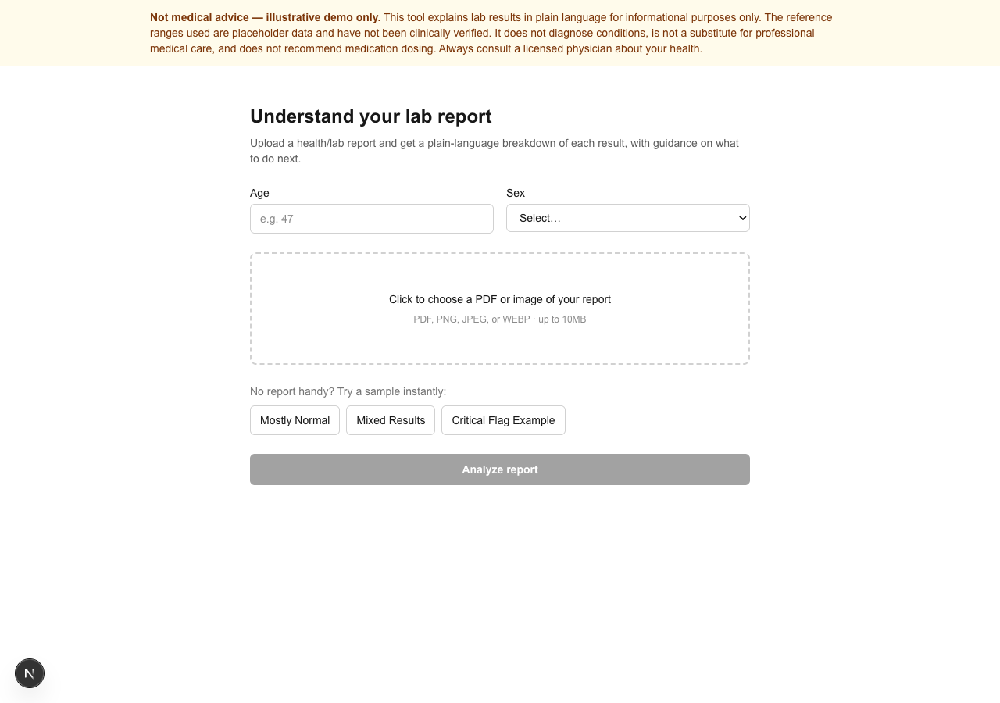
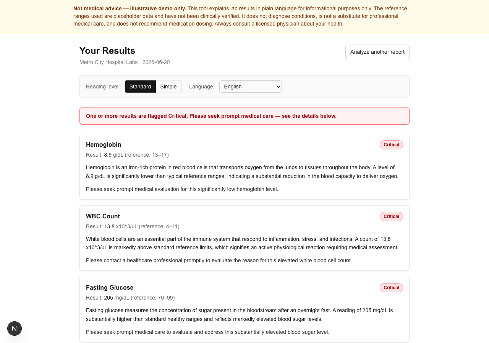
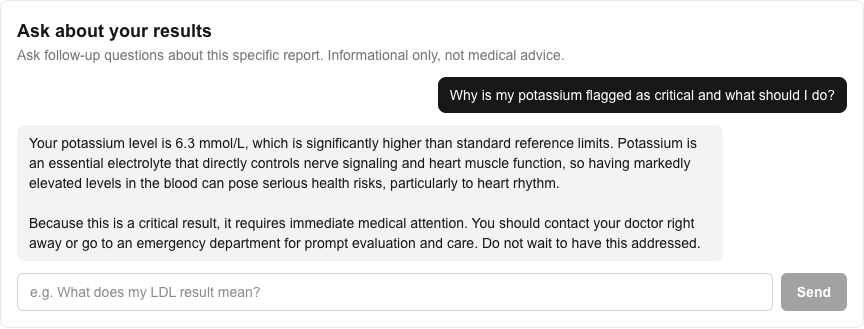

# Health Report Explainer

**[Try it live →](#)** &nbsp;|&nbsp; An AI-assisted app that reads a lab report (PDF or image), classifies each result against reference ranges, and explains it in plain language — with the classification and the explanation deliberately handled by two different systems.

## The problem

Lab reports hand people a wall of numbers and a tiny reference range column, and leave the interpretation to a follow-up appointment that might be weeks out. Most people can't tell "this is mildly outside normal and worth mentioning next visit" from "this needs attention this week" — so everything either gets ignored or triggers a 2am symptom-search spiral. This app gives a same-day, plain-language read on each result, tiered by actual urgency, with a clear answer to the one question that matters most: *should I see someone about this, and how soon?*



## Why this is interesting

The core design decision: **an LLM should never be the thing deciding whether a result is dangerous.**

Most "AI explains your lab report" demos hand the whole job to the model — extraction, classification, and explanation all in one prompt. That's fast to build and easy to get subtly wrong, since a model's idea of "borderline" vs. "critical" isn't grounded in anything auditable.

This app splits the pipeline into three stages with a hard boundary between them:

```
PDF/image
   │
   ▼
① Extraction (Gemini, structured JSON output)
   Reads test_name / value / unit off the document. Nothing else — no judgment calls.
   │
   ▼
② Classification (classifier.py, deterministic)
   A plain Python rules engine checks each value against an age/sex-aware reference
   table (reference_ranges.json) and assigns NORMAL / BORDERLINE / CRITICAL / UNKNOWN.
   No model call. Invoked from the Next.js API route via a stdin/stdout subprocess.
   │
   ▼
③ Explanation (Gemini, tier is a locked input)
   Gemini explains *why* a result matters, suggests safe lifestyle steps, and tells the
   user when to see a doctor — grounded in the tier from step ②, which it cannot see a
   way to change: the response schema has no "tier" field at all, so there's structurally
   nowhere for a different opinion to go, even if the model tried to express one.
```

One consequence of building it this way: I found a real bug. `classifier.py`'s own bundled self-test was failing 2 of 9 cases — the comparison logic read the "borderline" cutoffs into variables and then never used them, so a result had to cross the far more extreme "critical" cutoff before being flagged, silently under-classifying things like a hemoglobin of 8.9 g/dL as merely borderline. Because classification is deterministic and testable in isolation, that was a two-line fix with a clear before/after instead of an AI hallucination I'd have had to take on faith.

## Features

- **Upload or try a sample** — PDF/image upload, or three synthetic sample reports (normal / mixed / critical) for an instant demo with no real data needed
- **Deterministic risk tiering** — age/sex-aware classification against an editable reference-range table, not an LLM guess
- **Tentative fallback for unrecognized tests** — if a test isn't in the reference table, the app falls back to the report's own printed range, or Gemini's general medical knowledge if no range is printed — always visibly flagged "Tentative," never confused with a verified result
- **Ask Your Report** — follow-up chat grounded only in that specific report; refuses to answer about tests not present rather than inventing data
- **Reading-level & language toggle** — re-expresses the same locked results as plain/simple language or in another language, without ever re-deciding a tier
- **Safety-constrained throughout** — no diagnostic language, no medication names or dosing, explicit "seek care now" framing for anything critical, persistent non-medical-advice disclaimer





## Tech stack

- **Frontend/API:** Next.js (App Router), TypeScript, Tailwind CSS
- **AI:** Google Gemini (`@google/generative-ai`), structured JSON output mode
- **Classification:** Python (stdlib only), invoked from Node via `child_process`
- **Storage:** none for the active pipeline — fully stateless per session by design

> Note: an earlier iteration of this project used Gemini to assign risk tiers directly and stored report history in SQLite for round-over-round comparison. That code is still in the repo (`src/lib/interpret.ts`, `src/lib/reports.ts`, the `/history` page) but disconnected from the active UI after the architecture above replaced it — kept rather than deleted in case it's worth reviving.

## Running locally

```bash
npm install
cp .env.local.example .env.local   # add your GEMINI_API_KEY (free tier at aistudio.google.com)
npm run dev
```

Open [http://localhost:3000](http://localhost:3000). Python 3 must be on `PATH` for the classification step (`classifier.py` / `classify_cli.py`).

## Important caveats

- **`reference_ranges.json` is illustrative placeholder data for a portfolio project**, not clinically verified. A real deployment would need a qualified SME to own and source that table from an authoritative reference. This is surfaced directly in the UI's persistent disclaimer.
- This tool never produces diagnostic language, medication names, or dosing — informational only, not a substitute for professional care.
